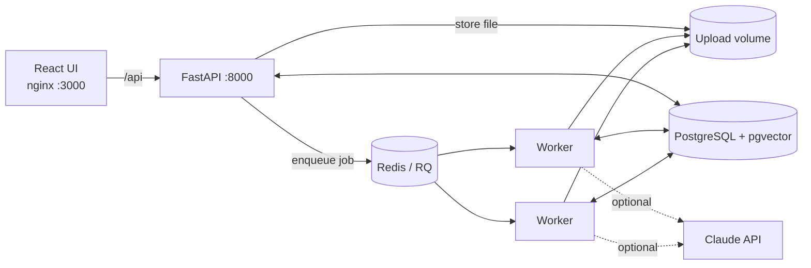
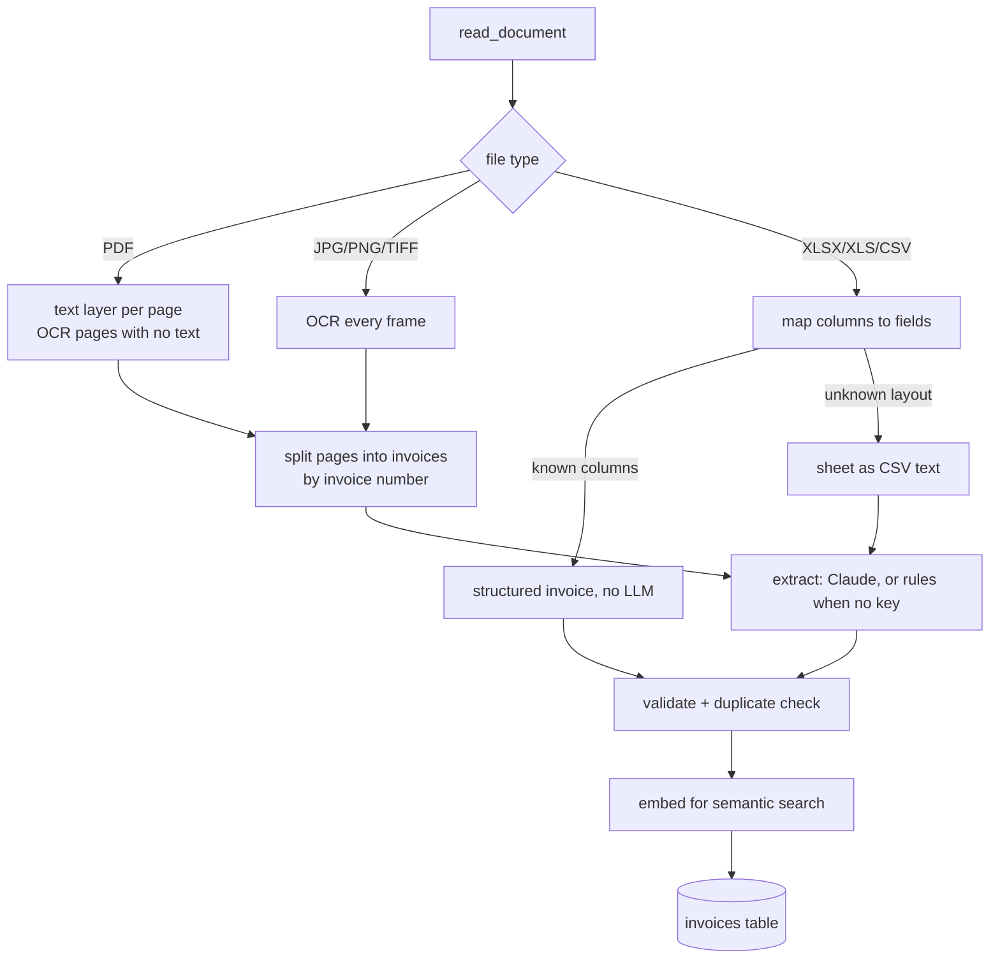
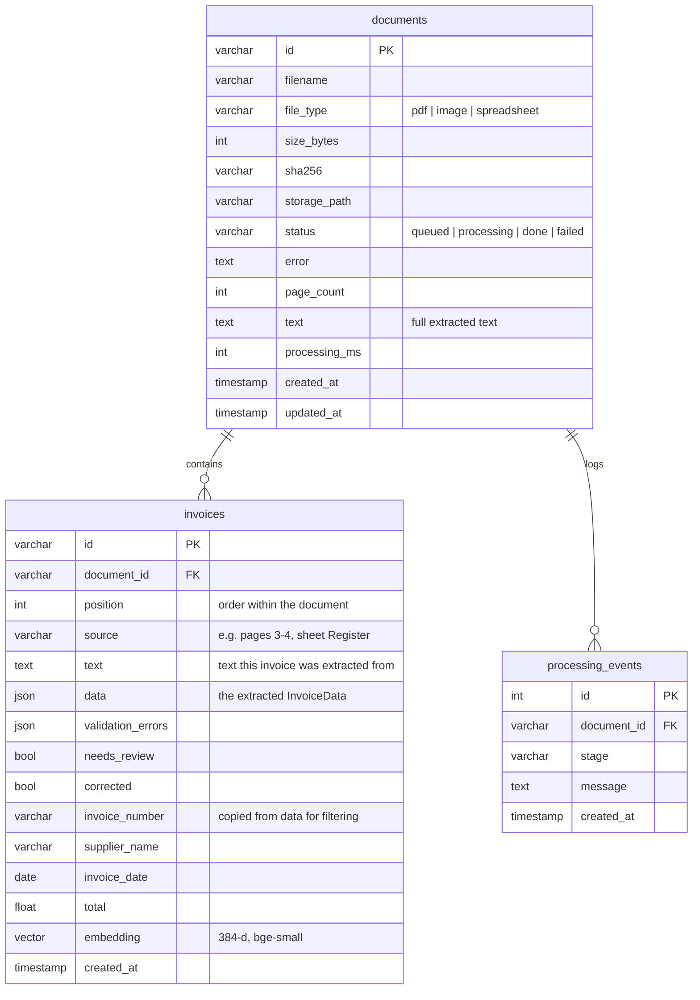

# Architecture

## Request flow

1. `POST /api/documents` streams each file to the upload volume under a generated
   name, computes its SHA-256, creates a `documents` row with status `queued` and
   pushes a job onto the `documents` queue. The request returns immediately.
2. A worker picks up the job and runs the pipeline:

3. Every stage writes a row to `processing_events`, which the UI shows as the
   document's history. A failure stores the error on the document and sets it to
   `failed`; `POST /documents/{id}/reprocess` puts it back on the queue.

## Database schema

Indexes: `status`, `sha256`, `invoice_number`, `supplier_name`, `needs_review`, and a
GIN index on `to_tsvector('english', invoices.text)` for keyword search. At this data
size, pgvector does an exact scan; an HNSW index on `embedding` is a one-line
addition when the table gets big.

## Design decisions

**Python end to end.** The heavy lifting (Tesseract, PyMuPDF, pandas) is in Python,
so the API is FastAPI too, not NestJS. That means one language, one set of models,
and no RPC layer between a Node API and a Python worker.

**One document, many invoices.** A 1000-page PDF is usually a batch of invoices,
not a single one. Pages are grouped by the invoice number printed on them;
pages without a number (terms, continuation pages) are attached to the invoice
before them. Spreadsheets are grouped by their invoice-number column.

**Spreadsheets skip the LLM when they can.** If a sheet has columns we recognise
(invoice number, total, vendor, ...), the values are read directly. That is exact,
free and fast. Only sheets with an unknown layout go through text extraction.

**OCR only where needed.** Each PDF page uses its text layer when it has one; only
pages with almost no text are rendered and sent to Tesseract. OCR runs in a thread
pool (Tesseract is a subprocess, so threads run in parallel), with pages rendered in
small batches so memory stays flat on very large scans.

**Extraction never invents values.** The Claude prompt asks for printed values only,
with `null` for missing fields and an `uncertain_fields` list for anything it could
not read clearly. Structured output (`messages.parse` with a Pydantic model)
guarantees the response matches the schema. Without an API key, a rule-based
extractor handles clearly labelled fields and leaves the rest empty. Uncertain
fields show up as validation issues, so they get reviewed.

**Validation is plain code, not the LLM.** Missing required fields, negative
amounts, invalid or future dates, quantity x price vs. line amount, line items vs.
subtotal, subtotal + tax vs. total (with a 2-cent tolerance), and duplicates (same
invoice number and supplier). Any issue sets `needs_review`.

**PostgreSQL for everything.** Metadata, JSON results, full-text search and vectors
(pgvector) live in one database. A separate vector store would add another
service to run without changing the results at this scale.

**Local embeddings.** `BAAI/bge-small-en-v1.5` through fastembed (ONNX, CPU) is
baked into the image, so semantic search works offline and costs nothing per query.

**Cross-verification.** `GET /api/reconcile?left=&right=` matches invoices across
two documents by invoice number and lists field differences plus invoices that
appear on one side only. This covers the PDF-vs-PDF and PDF-vs-Excel checks from
the brief.

## Scaling and reliability

- Workers are stateless; add replicas (`deploy.replicas` in compose) to process
  more documents in parallel. The API never does OCR or LLM work itself.
- Claude calls inside one document run 4 at a time; the SDK retries 429/5xx.
- Reprocessing deletes the old invoices for that document first, so it is safe to
  run as often as needed.
- Job timeout is 3 hours to cover very large scans.

## Security

- Upload whitelist by extension, a size limit (default 200 MB, streamed and
  checked as it arrives), and files saved under random names, so a user-supplied
  filename is never used as a path.
- Optional API key (`API_KEY`), compared in constant time.
- All SQL goes through SQLAlchemy with bound parameters.
- Containers run as a non-root user; Postgres and Redis are not exposed to the host.
- Document text is passed to the LLM as data, and the prompt tells the model to
  ignore any instructions inside the document.
- Error messages shown to users don't include internal paths.

## What I would add for production

- Real authentication (SSO/OIDC) and per-user audit of corrections, instead of a
  shared API key.
- Alembic migrations instead of `create_all`.
- Object storage (S3) for uploads, plus virus scanning.
- A dead-letter view and automatic retries for transient LLM failures.
- Language packs for Tesseract beyond English, and a deskew step for photos.
